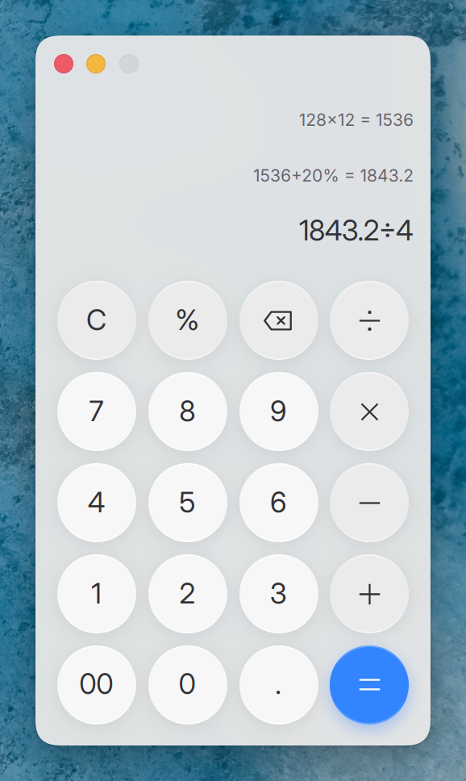

# Calculator

A simple calculator for Cutefish Desktop, and nothing more: + − × ÷ and
percentages on a keypad you can also drive from the keyboard, with the last
calculations above the one you are typing.



## Dependencies

Calculator uses cutefish-toolkit; GoogleTest for the tests.

```sh
sudo apt install cmake libgtest-dev
```

## Build and install

```sh
mkdir build
cd build
cmake -DCMAKE_INSTALL_PREFIX=/usr ..
make
sudo make install
```

## Tests

```sh
cmake -DBUILD_TESTING=ON ..
make
ctest --output-on-failure
```

## License

BSD-3-Clause; see [LICENSE](LICENSE).
